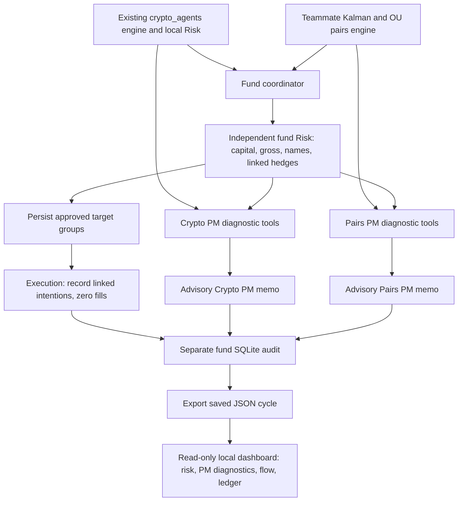
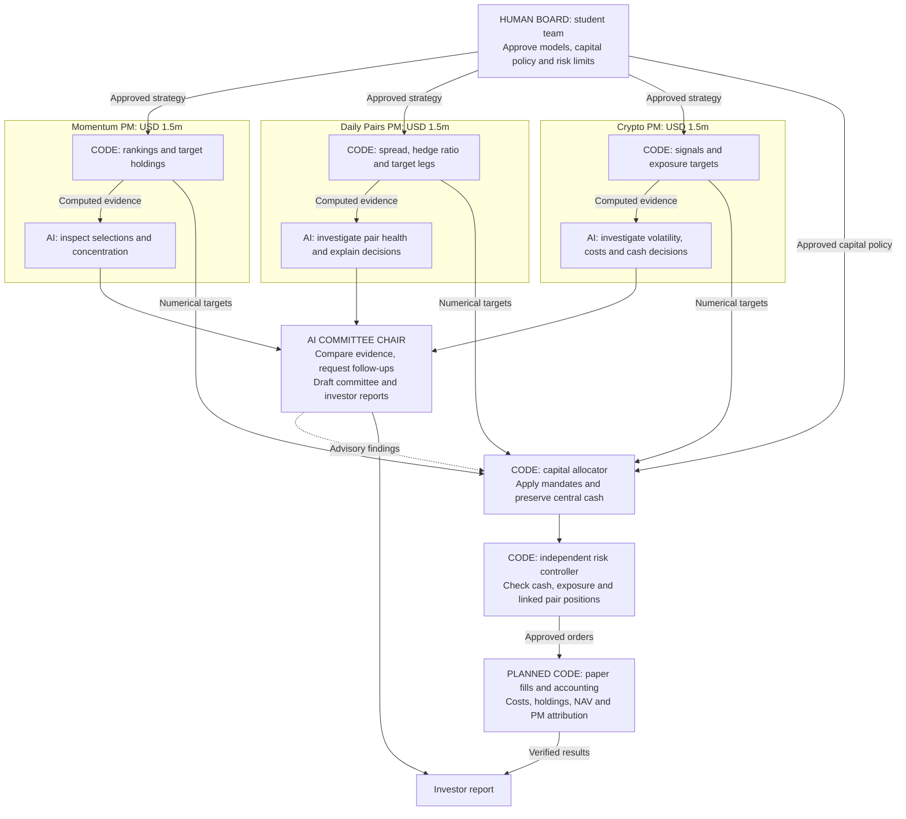
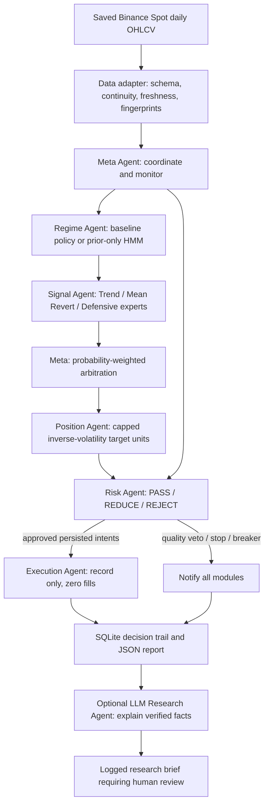

# Crypto and pairs PM agent infrastructure

## Fund coordinator added on 14 October 2026

`fund_agents` connects the existing Crypto PM to the teammate's daily Kalman/OU
Pairs PM. Each PM owns its quantitative engine and has a representative exposing
read-only signal, model-health and position tools. Imported AI memos are checked
against computed evidence after quantitative risk decisions.



The shared fund contracts allow signed pair quantities and retain both legs in
one group. Crypto's internal nonnegative Spot contracts are retained by its
adapter. Fund risk counts gross exposure before netting and uses common scaling
to preserve dollar hedge ratios. Equity calendars, last actual session dates,
and explicit USD/USDT or dated foreign-currency valuations are exposed in the
reports. Confirmed snapshots supply holdings; intention records never become
fills. Fund and crypto breaker state persist together in the separate fund store.

Run `python -m fund_agents` for the invented-data demo. The
[integration guide](fund_agents/README.md) covers historical research,
confirmed positions, imported PM replies and output files. Momentum is an
unconnected cash reserve. Automatic LLM calls, executable lot sizing and borrow
checks, paper fills, and consolidated performance are not implemented here.

`python -m fund_agents.dashboard` serves the local frontend on
`http://127.0.0.1:8765`. Its GET-only report API indexes coordinator JSON exports
and serves reports only by indexed relative identity. Static assets are local
and explicitly allowlisted. The frontend shares one selected cycle across its
overview, risk, PM, flow and audit views; it displays valuation dates and demo
provenance, leaves missing measurements unavailable, and keeps approved target
exposure separate from confirmed account holdings. It does not invoke PMs,
connect to exchanges, or mutate SQLite. New reports appear on manual refresh.

## Human, AI and code ownership (proposed)

The student team acts as the human Board. It approves the strategy definitions,
capital policy, evaluation assumptions and risk limits. The daily paper cycle can
run automatically within that policy. Humans review exceptions and policy changes.

Each PM combines a quantitative engine with an AI representative. The proposed
Investment Committee / CIO includes an AI chair for evidence review and a coded
allocator for the approved capital policy. Its initial USD 5 million paper mandate
assigns USD 1.5 million to each PM and USD 0.5 million to central cash.



| Owner | Responsibility | Reason for this boundary |
| --- | --- | --- |
| Human team | Define and validate strategies, approve policy, freeze evaluation assumptions | The team is accountable for the investment objective and submitted evidence |
| AI representatives and committee chair | Choose diagnostic investigations, compare findings, ask follow-ups and explain evidence | Different PM mandates need contextual review and discussion |
| Quantitative code | Calculate signals, targets, allocation, limits, costs and accounting | Results and trading decisions must be reproducible and testable |

The diagram describes the intended architecture. The current implementation
connects crypto and pairs, provides a read-only local dashboard, and records
intentions with zero fills. Momentum, an AI committee chair, automatic model
calls, autonomous tool selection, fund fills and consolidated P&L remain pending.
Current default PM memos use deterministic diagnostics. Optional imported AI
replies are checked against the computed evidence and have no trading authority.
The existing memos run after risk; the proposed chair's advisory input is future
work and cannot bypass the coded capital policy or risk limits.

For the class demonstration, show real diagnostic requests, their returned
records, PM explanations and a committee follow-up. Label any illustrative
exchange or synthetic input. Reporting text alone does not establish that an
autonomous agent ran. The [PM guide](fund_agents/README.md#ai-pm-diagnostics-and-memos)
records the implemented boundary.

## Existing crypto infrastructure from 9 October 2026

Implemented 9 October 2026. The structure follows the supplied BURSA architecture:
one local Python process with explicit ownership, typed messages, a final Risk
veto, persisted state, and record-only Execution. Existing research models and
the separate daily paper-account workflow remain available.



Meta calls each module in order. Signal specialists do not submit orders. Position
only proposes. Risk approves, resizes or rejects; Meta cannot override its decision.
Execution verifies that the exact Risk decision is persisted before recording an
intent. A raw order or modified approval is rejected.

## Existing capabilities fitted into agents

| Module | Reused capability | Phase-1 behavior |
|---|---|---|
| Data adapter | Binance daily files; existing public client and archive loader | Audit exact local bytes; preserve gaps and labels |
| Meta | Existing daily orchestration concepts | One atomic SQLite cycle, notifications and report |
| Regime | `GaussianHMM2`, stationary return/volatility features | Baseline: trend-only policy. Optional experiment fits strictly before inference |
| Signal | Existing adaptive SMA and Sharpe gate | Trend expert, simple holdings-aware Bollinger expert, defensive cash expert |
| Position | Existing capped inverse-volatility sizing | Long-only fractional crypto units, next-period target proposal |
| Risk | Existing exposure/volatility constraints | Independent caps, fee/cash budget, prior-ADV liquidity cap, stops and latched drawdown breaker |
| Execution | Explicit BURSA-style boundary | Idempotent intent records; no fills or portfolio changes |
| LLM Research | Wayland Lesson 14 research boundary | Optional imported structured reply; no provider call or order authority |

`config/agents.research.json` retains the assignment's adaptive strategy. Its
Regime Agent explicitly declares a policy with 100% trend routing; those weights
are not HMM probabilities. `config/agents.hmm_experiment.json` enables a separate
unvalidated routing experiment: high volatility -> trend, low volatility -> mean
reversion, defensive weight zero. Volatility does not establish a crisis. The
new architecture and HMM blend have no newly measured performance claims.

## Data engineering gate

`crypto_quant/data_quality.py` checks required columns, explicit timezone offsets,
finite positive prices, OHLC ordering, volume bounds, integer trade counts, unique
ordered timestamps, UTC interval alignment, completed candle boundaries,
continuous 24/7 coverage, minimum history and the expected last completed bar.
Zero-volume decision bars block proposals. Large moves and older zero-volume bars
are preserved as warnings. No gap filling, duplicate removal or price repair is
performed by the gate.

The local agent adapter audits all available rows through the requested date and
explicitly counts future rows excluded for historical replay. It reads each file
once and fingerprints those exact bytes. A failed file supplies no usable bars;
Risk vetoes the cycle. Audit and snapshot hashes bind reports to inputs. These are
structural checks, not independent verification of the venue, listing history,
survivorship, bid/ask liquidity, or revised data. The existing daily public runner
also verifies listing dates before this gate.

`run_daily_pipeline()` now writes `live/data_quality.json` before any portfolio
processing and refuses stale or corrupt input. On quality failure it leaves
portfolio ledgers unchanged; the quality file records the failed attempt even if
an older successful run manifest still exists. The public client rejects duplicate
or unordered candles rather than silently dropping them.

Future runs of `scripts/prepare_klines.py` add per-dataset quality sidecars,
normalized-output SHA-256 hashes, raw-archive fingerprints and per-dataset checksum
verification flags. Existing processed files/manifests have not been regenerated.
Known hourly gaps remain visible and can cause a structural FAIL; checksum success
does not make a gapped window suitable for a continuous daily model.

## State and risk boundaries

- Frozen dataclasses carry snapshots, routing, signals, proposals and decisions.
- SQLite cycle/events/decisions/intents tables reject UPDATE and DELETE through
  triggers. Mutable account state holds the breaker. This is operational logging
  inside a trusted process, not external tamper-proof storage.
- A transaction covers approvals, intent records, breaker state and event history.
  A crash before commit rolls the cycle back. JSON exports can be recovered from
  SQLite if exporting fails after commit.
- Intent identities are derived from inputs, portfolio and policy. Repeating an
  unchanged proposal in one account produces `ALREADY_RECORDED_NOT_EXECUTED`.
- Risk uses supplied cash for buys. Planned sale proceeds are never treated as
  available cash. Prior-day trailing quote-volume ADV caps order notional; that
  cap is a research estimate, not an order-book fill model.
- The configured volatility target is estimated by Position from historical
  covariance; it is not a guaranteed future-volatility ceiling.
- Stops and take-profit thresholds generate exit requests. No requested exit is
  a promised fill. The drawdown breaker survives restarts and has no automatic
  reset. A separate account key/database is required for an independent replay.
- Unknown active specialist inputs hold the proposed portfolio. Independently
  triggered Risk exit requests can still be recorded on valid data.
- The agent CLI never changes `live/paper_state.json`, positions, cash, P&L or
  the assignment CSV. The existing daily runner remains the paper-fill workflow.

## LLM role

Following [Wayland Zhang, Lesson 14](https://waylandz.com/quant-book-en/Lesson-14-LLM-Applications-in-Quant/),
LLM research runs after quantitative decisions. It receives computed facts and a
digest, and may return a summary, observations, risk flags, suggested experiments
and copied metric claims. Each claim must match an input metric. Raw reply, parsed
output, claimed model identity, prompt version, facts, timestamp and result are
logged. Free-text claims and causality require human review. No LLM API integration
or model execution is claimed in this phase; imported replies are explicitly
optional and the model name is supplied by the caller.

To supply a reply, take `llm_research.input_facts`, `input_sha256` and `system_prompt`
from a run report. Save a response envelope under ignored `local_llm/`:

```json
{
  "model": "your-provider-model-id",
  "input_sha256": "digest-from-the-report",
  "output": {
    "summary": "Research summary for human review",
    "observations": [],
    "risk_flags": [],
    "suggested_research": [],
    "metric_claims": [{"name": "filled_orders", "value": 0}]
  }
}
```

Pass `--llm-response local_llm/reply.json` to an otherwise identical cycle. A
schema, digest or metric mismatch is logged as `REJECTED`; execution decisions
are unaffected. The default report says `NOT_REQUESTED`, not an invented LLM brief.

## Run locally

```powershell
.\.venv\Scripts\python.exe -m crypto_agents --config config/agents.demo.json
.\.venv\Scripts\python.exe -m crypto_agents --config config/agents.demo.json --scenario reduce
.\.venv\Scripts\python.exe -m crypto_agents --config config/agents.demo.json --scenario flagged
.\.venv\Scripts\python.exe -m crypto_agents --config config/agents.demo.json --scenario breaker
.\.venv\Scripts\python.exe -m crypto_agents --config config/agents.research.json --data-dir live/market_data --as-of 2026-09-16
.\.venv\Scripts\python.exe -m unittest discover -s tests -v
```

The September date is an explicit historical replay of the current cached daily
files. It does not claim current October coverage. Research runs use an empty
hypothetical portfolio unless `--portfolio local_portfolios/snapshot.json` is
supplied. Required portfolio fields: `as_of`, `cash_usdt`, `peak_equity_usdt`, and
`holdings` containing `symbol`, `units`, `entry_price`. Dates must match the market.

Audit current freshness without changing local data:

```powershell
.\.venv\Scripts\python.exe scripts/audit_market_data.py live/market_data/BTCUSDT_1d.csv live/market_data/ETHUSDT_1d.csv --closed-at 2026-10-09T00:00:00Z --expected-last 2026-10-08 --minimum-rows 520
```

Status codes: 0 for a completed inspection/intent cycle; 2 for quality/risk veto,
breaker or input hold. Runtime state and per-cycle reports are ignored by Git.
The verified test/evidence summary is in `reports/agents/implementation_report.md`.

Deferred: direct LLM provider integration, authenticated exchange execution,
multi-process permissions, continuous monitoring, and a new agent-strategy
backtest. The assignment's October paper run must be activated separately.
