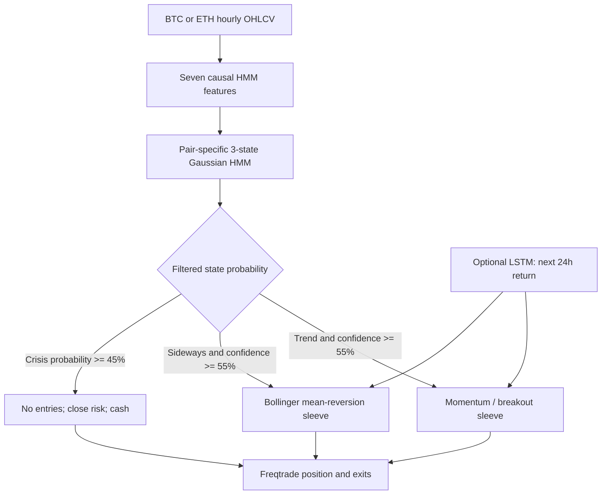

# BTC/ETH three-regime Freqtrade baseline

## Bottom line

The three-regime design works technically, but the first combined strategy is not the best
version. On the 2025 benchmark, the HMM trend-only control returned **19.58%** with a **4.66%**
maximum wallet drawdown. Adding the sideways mean-reversion sleeve reduced the combined result to
**12.89%** with **8.25%** drawdown. Adding the LSTM forecast gate reduced it again to **7.18%**
with **7.09%** drawdown.

The sideways-only control lost **11.01%** and drew down **13.68%**. The evidence therefore says:

1. Keep the HMM as a causal regime router and crisis risk switch.
2. Advance the trend-only version as the next research candidate.
3. Disable the mean-reversion sleeve until it passes development folds on its own.
4. Do not add the LSTM gate by default; it lowered return and Sharpe in this test.

This is research evidence, not a live-trading recommendation. The reviewed 2025 period is now a
consumed benchmark, and the repository has no complete 2026 candles for a fresh holdout.

## Architecture



The HMM is a gatekeeper, not a direct price predictor. For every candle it updates the probability
of each state using only observations available through that candle:

```text
P(state_t = j | x_1:t) proportional to
    Normal(x_t | mean_j, variance_j)
    * sum_i P(state_(t-1) = i | x_1:t-1) * transition_(i,j)
```

No future-aware smoothed probability or full-sample Viterbi path is used in the strategy.

## What each state and sleeve does

### Trend

The entry needs all of the following:

- HMM label `trend`, confidence at least 55%, crisis probability below 45%.
- Price crosses the outer 20-day Bollinger band at 1.5 standard deviations.
- EMA 24 is above EMA 120 for a long, or below for a short.
- MACD histogram and RSI 55/45 agree with direction.

The trade exits at a confirmed regime change, a crisis switch, the 20-day middle band, or the 15%
emergency stop. Long and short entries are supported, but Freqtrade cannot hold both directions in
the same pair simultaneously.

### Sideways

The entry needs the HMM `sideways` label and the same confidence/risk checks. It fades a two-
standard-deviation move around a seven-day Bollinger mean: buy below the lower band with RSI below
35, or short above the upper band with RSI above 65. It exits at the middle band, a state change,
crisis, or emergency stop.

This is not a grid strategy. It opens one directional position per pair and does not average down.

### Crisis

When crisis probability reaches 45%, the strategy blocks new entries and closes existing longs or
shorts. It then stays in cash until risk falls. It does not automatically short merely because the
state is `crisis`.

### Optional LSTM

The LSTM sees the previous 48 hourly vectors of 18 causal price, volatility, volume, RSI, moving-
average-distance, and calendar features. It forecasts the next 24-hour log return. A trend trade
requires a forecast beyond +0.20% for a long or below -0.20% for a short; a sideways trade requires
only the matching sign. The HMM still chooses the sleeve, and the LSTM only accepts or rejects an
entry.

## HMM fit

The scaler and HMM parameters were fit separately for BTC and ETH on 2020-01-01 through
2024-12-31. Five initializations were tried per pair and the highest training likelihood was kept.
The seven inputs are 24-hour return, 24-hour volatility, 168-hour volatility, their ratio,
absolute distance from the 120-hour average, drawdown from the 168-hour high, and 168-hour volume
z-score.

| Pair/state | Development observations | Mean 24h return | Mean 168h vol | Mean trend strength | Mean 168h drawdown |
|---|---:|---:|---:|---:|---:|
| BTC crisis | 8,294 | -0.142% | 1.017% | 6.48% | -9.91% |
| BTC trend | 20,519 | +0.323% | 0.610% | 3.01% | -4.41% |
| BTC sideways | 14,867 | +0.031% | 0.423% | 1.14% | -2.80% |
| ETH crisis | 7,572 | -0.363% | 1.333% | 8.70% | -13.14% |
| ETH trend | 19,907 | +0.480% | 0.786% | 4.10% | -5.51% |
| ETH sideways | 16,201 | +0.049% | 0.529% | 1.42% | -3.55% |

Those statistics support the semantic labels: the crisis state has the highest volatility and
deepest drawdown; sideways has the lowest volatility and trend strength. On 2025 daily closing
states, BTC had 136 trend, 205 sideways, and 24 crisis days; ETH had 187 trend, 129 sideways, and
49 crisis days.

## 2025 results

All four runs use 10,000 USDT starting capital, 5,000 USDT stakes, at most two open positions,
isolated futures, 1x leverage, and 0.10% fees on both entry and exit. Funding and slippage are not
included.

| Strategy | Return | Max drawdown | Daily wallet Sharpe | Profit factor | Trades | BTC | ETH |
|---|---:|---:|---:|---:|---:|---:|---:|
| HMM trend only | **19.58%** | **4.66%** | **1.32** | 1.62 | 49 | +7.04% | +12.54% |
| HMM sideways only | -11.01% | 13.68% | -1.82 | 0.49 | 41 | -7.33% | -3.68% |
| HMM trend + sideways + crisis | +12.89% | 8.25% | 0.82 | 1.25 | 89 | +3.47% | +9.41% |
| HMM + both sleeves + LSTM gate | +7.18% | 7.09% | 0.58 | 1.22 | 56 | -4.06% | +11.24% |

For context, the earlier pure 40-day Bollinger-breakout control returned 54.71%, with 9.03%
drawdown and 1.40 daily wallet Sharpe. It was much more concentrated: ETH supplied 55.49
percentage points while BTC lost 0.78. The HMM trend control had lower return but roughly halved
drawdown and made money in both assets. This comparison is diagnostic, not a fair new holdout,
because all results have now been inspected.

## Sleeve and exit diagnostics

In the combined deterministic strategy, 48 trend trades earned **2,203.29 USDT**, while 41
sideways trades lost **914.74 USDT**. In the LSTM version, 30 trend trades earned **1,275.97 USDT**
and 26 sideways trades lost **557.52 USDT**. The neural gate cut both good and bad trades, but the
net effect was negative.

For the combined deterministic run:

| Exit reason | Trades | Net P&L | Winners |
|---|---:|---:|---:|
| Crisis to cash | 15 | +3,491.43 USDT | 15 |
| Mean-reversion middle | 12 | +984.55 USDT | 11 |
| Forced end-of-test exit | 1 | +22.00 USDT | 1 |
| Trend middle | 3 | -866.82 USDT | 0 |
| Regime change | 58 | -2,342.61 USDT | 12 |

The outer-band fades can work when price reaches the middle, but frequent regime-change exits
realize losses first. The next development experiment should test persistence or hysteresis—for
example requiring the new state for two or three candles—rather than simply widening the band on
2025. The perfect crisis-exit win count should not be treated as independent proof: many were
profitable short trades closed as volatility entered the crisis state.

## Cost stress

| Strategy | Fee per side | Return | Max drawdown | Wallet Sharpe | Profit factor |
|---|---:|---:|---:|---:|---:|
| HMM three sleeve | 0.05% | +16.17% | 8.28% | 1.01 | 1.33 |
| HMM three sleeve | 0.10% | +12.89% | 8.25% | 0.82 | 1.25 |
| HMM three sleeve | 0.20% | -0.92% | 9.04% | -0.01 | 0.98 |
| HMM trend only | 0.05% | +22.03% | 4.30% | 1.47 | 1.72 |
| HMM trend only | 0.10% | +19.58% | 4.66% | 1.32 | 1.62 |
| HMM trend only | 0.20% | +14.69% | 5.40% | 1.02 | 1.43 |

The combined model is too cost-sensitive at high fees. The trend-only control survives the same
stress because it trades less and avoids the losing sideways turnover. Explicit slippage and
historical funding still need to be added.

## Volume, macro variables, and cross-market data

Volume analysis **is included**: the HMM receives a 168-hour log-volume z-score, and the LSTM
receives both volume change and volume z-score. Stock indices and interest rates **are not included
in this baseline**, because the requested experiment uses the local BTC/ETH files and there are no
time-aligned macro series in that folder.

Do not hard-code an assumed inverse relationship. BTC can change sign against rates and equities
across periods. When macro data is added, use lagged returns and rate changes as observable
features, fit them only inside each training fold, and compare against the price/volume-only
control. Suitable first candidates are S&P 500 or Nasdaq returns, VIX changes, the two-year yield,
the ten-year yield, and the dollar index. Handle non-trading hours and publication timing without
forward-filling information before it was actually available.

## Validation and limitations

- Unit checks prove that changing future candles does not change earlier regime features or
  forward-filter probabilities.
- Freqtrade's signal-slicing lookahead analysis tested 40 trend-only signals and reported zero
  biased entries, zero biased exits, and no biased indicators.
- The HMM was frozen before 2025; 2025 was not used to fit its scaler, transition matrix, means,
  or variances.
- The LSTM uses trailing 365-day windows and advances in 90-day blocks, but only seed 42 was used.
- The test excludes spread, slippage, historical funding, market impact, outages, and liquidation
  dynamics. It uses market orders in the configuration but candle-based simulated fills.
- Parameters were not tuned after viewing these results. The companion parameter protocol uses
  rolling 2022/2023/2024 development folds and small staged grids.
- The source files end at 2025-12-31. No claimed 2026 return is possible from this dataset.

## Artifacts

- `regime_dashboard.html`: interactive equity, comparison, sleeve, and regime charts.
- `full_trade_log.csv`: all 235 trades across the four regime runs.
- `strategy_summary.csv`: the four headline results.
- `all_strategy_summary.csv`: these runs plus the earlier Bollinger/RNN/GRU/LSTM/Transformer runs.
- `cost_stress.csv`: both candidate strategies at three fee levels.
- `report_data.json`: machine-readable report payload.
- `lookahead_analysis.csv`: Freqtrade bias-audit result for 40 trend-only signals.
- `parameter_selection.md`: development-only tuning and rejection rules.
