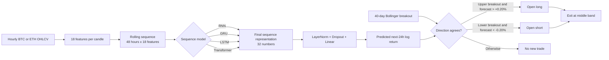
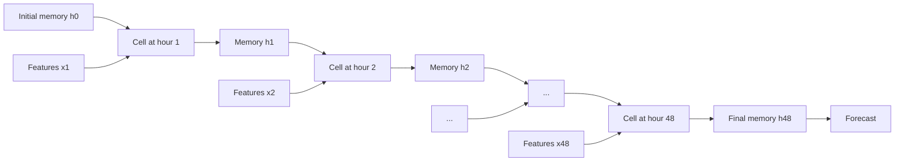
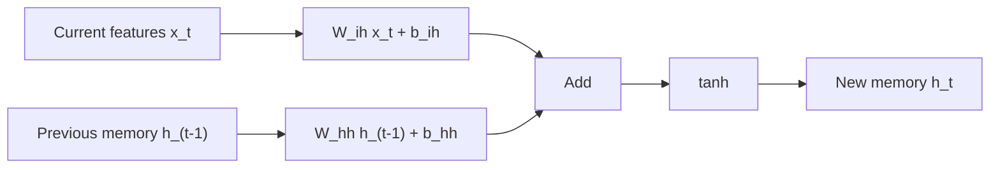
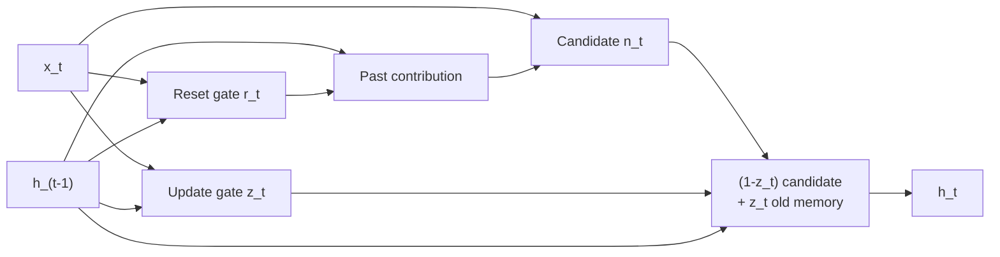
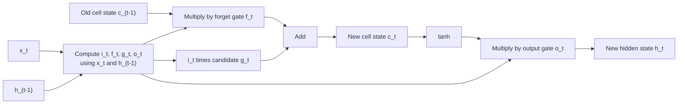
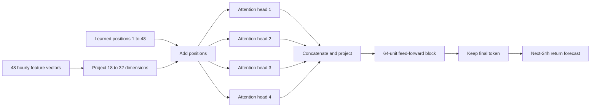
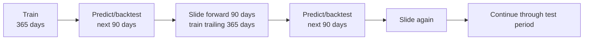
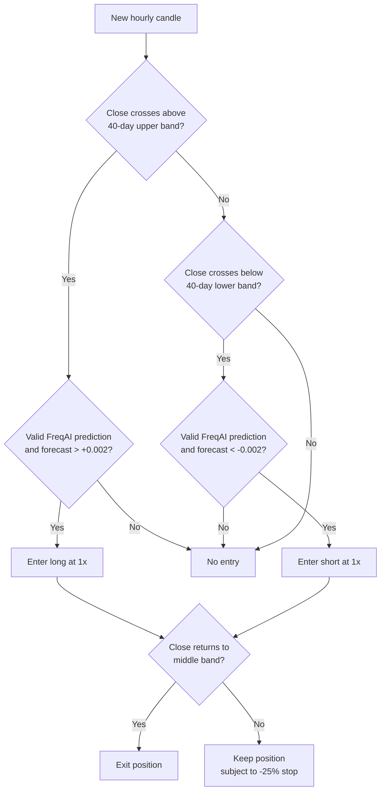
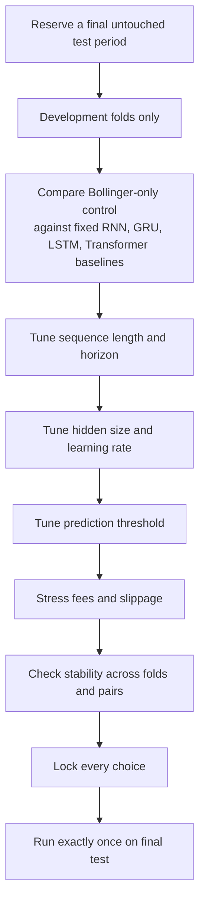

# Learning RNN, GRU, LSTM, and Transformers Through the BTC/ETH Strategy

This guide explains the mathematics and intuition behind the three recurrent models in this repository. It also traces exactly how a prediction becomes—or does not become—a BTC or ETH trade.

> Educational note: a backtest is evidence about one historical simulation, not proof that a model will make money live. The 2025 period has already been examined, so it should no longer be treated as an untouched test set.

## The whole idea in one picture

The neural network is **not the trading strategy by itself**. The Bollinger breakout proposes a trade, and the neural network acts as a directional gate.



The implementation is in:

- [`SequenceBreakoutStrategy.py`](../../user_data/strategies/SequenceBreakoutStrategy.py), which creates features, targets, and trading rules.
- [`PyTorchSequenceRegressor.py`](../../user_data/freqaimodels/PyTorchSequenceRegressor.py), which defines and trains all four sequence models.
- [`config_freqai_rnn.json`](../../user_data/config_freqai_rnn.json), [`config_freqai_gru.json`](../../user_data/config_freqai_gru.json), [`config_freqai_lstm.json`](../../user_data/config_freqai_lstm.json), and [`config_freqai_transformer.json`](../../user_data/config_freqai_transformer.json), which hold the experiment settings.

## First: what problem is the network solving?

At the end of hour \(t\), the model receives the latest 48 feature vectors:

$$
X_t = [x_{t-47}, x_{t-46}, \ldots, x_t]
$$

Each \(x_t\) contains 18 values. Therefore, one example has shape:

$$
48\ \text{timesteps} \times 18\ \text{features}.
$$

For a batch of \(B\) examples, the PyTorch input tensor is:

$$
X \in \mathbb{R}^{B \times 48 \times 18}.
$$

The target is the future 24-hour log return:

$$
y_t = \log\left(\frac{P_{t+24}}{P_t}\right).
$$

The network learns a function

$$
\hat y_t = f_\theta(X_t),
$$

where \(\theta\) represents all learned weights and biases. The output \(\hat y_t\) is one number—not a probability and not a guaranteed return.

For small moves, a log return is close to an ordinary percentage return. Thus:

$$
\hat y_t = 0.002 \approx +0.20\%, \qquad
\hat y_t = -0.002 \approx -0.20\%.
$$

The exact conversion back to a simple return is \(e^{\hat y_t}-1\).

## What are the 18 inputs?

The feature vector describes price movement, volatility, trend, volume, momentum, and time:

| Group | Features | What they try to describe |
|---|---|---|
| Returns | 1h, 6h, 24h log returns | Recent direction at three speeds |
| Candle shape | High-low range, open-close body | Intrahour movement and buying/selling pressure |
| Volume | Log-volume change, 168h volume z-score | Participation and unusual activity |
| Volatility | 6h, 24h, 168h rolling volatility | Short-, medium-, and week-scale risk |
| Trend | Price relative to 24h, 120h, and 960h means | Distance from daily, five-day, and 40-day trends |
| Momentum | RSI(14), scaled to 0–1 | Recent gain/loss balance |
| Seasonality | Sine/cosine of hour and weekday | Cyclical time without a false jump at midnight/Sunday |

Why use sine and cosine for time? Hour 23 and hour 0 are neighbors, but their raw numeric values are far apart. Mapping the hour around a circle preserves that relationship:

$$
\text{hour\_sin}=\sin(2\pi h/24), \qquad
\text{hour\_cos}=\cos(2\pi h/24).
$$

These are engineered clues, not truths. The network still has to learn whether any clue is useful.

## The common recurrent idea

A normal feed-forward network sees a fixed row. A recurrent network processes one timestep after another and carries a hidden state forward. The hidden state is a learned summary of the sequence seen so far.



The same cell parameters are reused at every hour. That weight sharing is what lets the cell learn a temporal rule such as “rising volume after a quiet period matters,” rather than learning 48 completely separate hour-specific models.

In this implementation, each hidden state contains 32 learned numbers:

$$
h_t \in \mathbb{R}^{32}.
$$

The entire output sequence has shape \(B \times 48 \times 32\), but the code keeps only the last state:

```python
sequence, _ = self.recurrent(x)
last_state = sequence[:, -1, :]
prediction = self.head(last_state)
```

The recurrent architectures differ mainly in **how they update memory**. The Transformer instead
uses attention to compare the timesteps directly.

---

## 1. Simple RNN

### Equation

PyTorch's basic tanh RNN computes:

$$
h_t = \tanh(W_{ih}x_t + b_{ih} + W_{hh}h_{t-1} + b_{hh}).
$$

Equivalent notation sometimes combines the two bias vectors into one. The important operations are:

1. Transform the current input \(x_t\).
2. Transform the previous memory \(h_{t-1}\).
3. Add them.
4. Compress every value through \(\tanh\), whose output lies between \(-1\) and \(+1\).



### Intuition

Imagine the hidden state as 32 continuously rewritten notes. At every hour, the cell mixes the new market information with its old notes, then rewrites all 32 notes at once.

The design is compact, but it has no explicit “keep this” or “forget this” controls. Useful older information must survive repeated nonlinear rewrites.

### Why long memory can be difficult

Training uses backpropagation through time. A simplified gradient from a late state back to an earlier state contains a product like:

$$
\frac{\partial h_T}{\partial h_t}
\approx
\prod_{k=t+1}^{T}
\operatorname{diag}(1-h_k^2)W_{hh}.
$$

Repeated multiplication can make gradients:

- shrink toward zero: **vanishing gradients**, so the model struggles to learn older dependencies;
- grow rapidly: **exploding gradients**, so training becomes unstable.

This does not mean an RNN remembers nothing. It means learning dependencies over many recurrent steps can be harder.

### Why still try it?

- It is the smallest and simplest baseline.
- Fewer parameters can help when data is limited.
- The relevant information may genuinely be recent.
- If it performs similarly to a gated model, the extra complexity may not be justified.

---

## 2. GRU: Gated Recurrent Unit

The GRU adds gates that decide how much past memory to preserve and how much new information to write.

### Equations used by PyTorch

$$
r_t = \sigma(W_{ir}x_t+b_{ir}+W_{hr}h_{t-1}+b_{hr})
$$

$$
z_t = \sigma(W_{iz}x_t+b_{iz}+W_{hz}h_{t-1}+b_{hz})
$$

$$
n_t = \tanh(W_{in}x_t+b_{in}+r_t\odot(W_{hn}h_{t-1}+b_{hn}))
$$

$$
h_t = (1-z_t)\odot n_t + z_t\odot h_{t-1}.
$$

Here:

- \(\sigma\) is the sigmoid function, producing values from 0 to 1;
- \(\odot\) means element-by-element multiplication;
- \(r_t\) is the **reset gate**;
- \(z_t\) is the **update gate**;
- \(n_t\) is the candidate new memory.



### What the two gates mean

The reset gate controls how much of the previous hidden state participates when forming the candidate \(n_t\). A small reset value allows the candidate to be based mostly on the new input.

The update gate controls the final mixture. Under PyTorch's convention:

- \(z_t \approx 1\): keep most of the old memory;
- \(z_t \approx 0\): replace it with the candidate.

Some articles write the update equation with the symbols reversed. Always check the implementation's convention.

### Tiny scalar example

Suppose one component has:

$$
h_{t-1}=0.50, \qquad n_t=0.10, \qquad z_t=0.80.
$$

Then:

$$
h_t=(1-0.80)(0.10)+(0.80)(0.50)=0.02+0.40=0.42.
$$

That component kept 80% of the previous memory and accepted 20% of the candidate. In the actual model this occurs separately across 32 components, so the GRU can preserve one kind of information while refreshing another.

### Why GRU can help

The final update is an interpolation rather than a complete rewrite. When \(z_t\) is near one, information and gradients have a relatively direct path through time. The GRU can therefore learn a “slow memory” and a “fast memory” inside different components of the same hidden vector.

---

## 3. LSTM: Long Short-Term Memory

The LSTM keeps two states:

- \(c_t\): the **cell state**, a longer-term memory path;
- \(h_t\): the **hidden state**, the exposed working memory/output.

### Equations

$$
i_t=\sigma(W_{ii}x_t+b_{ii}+W_{hi}h_{t-1}+b_{hi})
$$

$$
f_t=\sigma(W_{if}x_t+b_{if}+W_{hf}h_{t-1}+b_{hf})
$$

$$
g_t=\tanh(W_{ig}x_t+b_{ig}+W_{hg}h_{t-1}+b_{hg})
$$

$$
o_t=\sigma(W_{io}x_t+b_{io}+W_{ho}h_{t-1}+b_{ho})
$$

$$
c_t=f_t\odot c_{t-1}+i_t\odot g_t
$$

$$
h_t=o_t\odot\tanh(c_t).
$$

The gates are:

- **Forget gate \(f_t\):** how much of the old cell memory survives.
- **Input gate \(i_t\):** how much candidate information is written.
- **Output gate \(o_t\):** how much cell memory is exposed as the hidden state.
- **Candidate \(g_t\):** the proposed new content.



### Tiny scalar example

For one cell component, suppose:

$$
c_{t-1}=0.50, \quad f_t=0.90, \quad i_t=0.20, \quad g_t=0.40.
$$

Then:

$$
c_t=(0.90)(0.50)+(0.20)(0.40)=0.45+0.08=0.53.
$$

If \(o_t=0.70\), then:

$$
h_t=0.70\tanh(0.53)\approx0.34.
$$

The cell remembered most of the old value, added a smaller new value, and exposed only part of the result.

### Why the cell state matters

The update to \(c_t\) contains an additive path. Its direct derivative with respect to the previous cell state is approximately:

$$
\frac{\partial c_t}{\partial c_{t-1}}=f_t.
$$

If the forget gate learns values near one, information and gradients can travel through many steps with less decay. This is the central reason LSTMs are better equipped than a simple RNN to learn longer dependencies.

---

## 4. Transformer encoder

Unlike the recurrent models, the Transformer does not carry one state from hour to hour. It first
projects every 18-feature candle into a 32-dimensional token and adds a learned position vector:

$$
z_t=W_px_t+b_p+p_t.
$$

The position vector matters because attention alone does not know whether a token came from one
hour ago or 40 hours ago.

Each attention head creates queries, keys, and values, then computes:

$$
Q=ZW^Q, \qquad K=ZW^K, \qquad V=ZW^V,
$$

$$
\operatorname{Attention}(Q,K,V)
=\operatorname{softmax}\left(\frac{QK^\top}{\sqrt{d_k}}\right)V.
$$

A query represents what a timestep is looking for, a key represents what another timestep offers,
and a value carries the information that will be mixed. The dot products create 48-by-48 attention
scores. With four heads and model width 32, each head works in an eight-dimensional subspace.



Residual connections and LayerNorm surround both the attention and feed-forward blocks. They let
the layer preserve its input while learning adjustments.

No causal mask is needed here. The model emits only a forecast from the final token, and all 48
tokens are already historical when that forecast is made. A causal mask would be required if the
network produced an autoregressive forecast at every intermediate token.

The baseline Transformer has 10,785 parameters: 608 in the input projection, 1,536 learned
position values, 8,544 in the encoder layer, and 97 in the prediction head. It has more capacity
than any of the recurrent baselines, which increases overfitting risk on this small dataset.

---

## RNN vs GRU vs LSTM vs Transformer at a glance

| Property | RNN | GRU | LSTM | Transformer |
|---|---:|---:|---:|---:|
| Memory representation | \(h_t\) | \(h_t\) | \(h_t\) and \(c_t\) | 48 contextual tokens |
| Sigmoid gates | 0 | 2 | 3 | Attention, not recurrent gates |
| Main behavior | Rewrites memory | Mixes old and candidate memory | Controls forgetting, writing, and exposure | Directly compares all timesteps |
| Main strength | Simplicity | Memory/complexity compromise | Explicit long-memory controls | Short paths between distant timesteps |
| Main risk | Vanishing/exploding gradients | Gate saturation | More parameters and overfitting | Most parameters here and quadratic attention |

For input size \(F=18\) and hidden size \(H=32\), a one-layer PyTorch recurrent cell has:

$$
N_{RNN}=HF+H^2+2H=1{,}664,
$$

$$
N_{GRU}=3(HF+H^2+2H)=4{,}992,
$$

$$
N_{LSTM}=4(HF+H^2+2H)=6{,}656.
$$

The prediction head adds 97 parameters: 64 from LayerNorm and 33 from the final linear layer. Total trainable parameters are therefore:

| Model | Sequence block | Prediction head | Total |
|---|---:|---:|---:|
| RNN | 1,664 | 97 | **1,761** |
| GRU | 4,992 | 97 | **5,089** |
| LSTM | 6,656 | 97 | **6,753** |
| Transformer | 10,688 including projection and positions | 97 | **10,785** |

More parameters mean more flexibility, not automatically better forecasts. The network must estimate those parameters from noisy, non-stationary market data.

## What happens after the sequence model?

Only the final recurrent state or final Transformer token is sent into this prediction head:

$$
\hat y_t = W_o\,\operatorname{Dropout}(\operatorname{LayerNorm}(s_{48}))+b_o.
$$

For the recurrent models, \(s_{48}=h_{48}\). For the Transformer, \(s_{48}\) is the contextualized
final token.

### LayerNorm

LayerNorm recenters and rescales the 32 values within an example. This tends to make optimization more stable when different hidden dimensions acquire different scales.

### Dropout

During training, dropout randomly zeros some values so the prediction cannot rely too heavily on a single hidden component. It is disabled during inference.

There is an important implementation detail: because the recurrent network has only one layer, PyTorch recurrent dropout between layers is set to zero. The configured `dropout: 0.1` is active only in the prediction head. If `num_layers` were greater than one, it would also apply between recurrent layers.

### Linear layer

The linear layer reduces 32 hidden values to one forecast. It does not have a sigmoid because the target may be positive or negative and is not limited to \([0,1]\).

## How the network is trained

### Walk-forward structure

The backtest does not train once on all history. FreqAI repeatedly trains on a trailing 365-day window and predicts the next 90-day block.



Within each training window, the most recent 10% is used for validation. Both `shuffle` settings are false, so temporal order is preserved.

This matters because randomly mixing future and past observations would make the validation score unrealistically optimistic.

### One sample is itself a rolling window

FreqAI's `WindowDataset` constructs sequences of 48 consecutive rows. The model receives one window at a time and produces one label. With batch size 128, a training batch has shape approximately:

$$
128 \times 48 \times 18.
$$

### Huber loss

The model minimizes Huber loss between the prediction and target. With \(e=\hat y-y\) and \(\delta=1\):

$$
L(e)=
\begin{cases}
\frac{1}{2}e^2, & |e|<\delta,\\
\delta\left(|e|-\frac{1}{2}\delta\right), & |e|\ge\delta.
\end{cases}
$$

Near zero, it behaves like squared error and gives smooth gradients. For very large errors, it grows linearly and is less dominated by outliers than mean squared error. That is useful for crypto returns, which can contain unusual jumps.

The features and labels are transformed by FreqAI's fitted pipelines before model training; predictions are inverse-transformed before the strategy sees them. The transformation must be fitted only on the relevant training window to avoid leaking future distribution information.

### Optimization settings

The current baseline uses:

| Setting | Value | Meaning |
|---|---:|---|
| Optimizer | AdamW | Adaptive gradient steps with decoupled weight decay |
| Learning rate | 0.0003 | Step-size scale |
| Weight decay | 0.0001 | Mild parameter shrinkage |
| Maximum epochs | 6 | At most six passes through each training fold |
| Batch size | 128 | Training sequences per gradient batch |
| Early-stopping patience | 2 | Stop after two validation epochs without improvement |
| Random seed | 42 | Makes architecture comparisons more repeatable |

During learning, gradients answer: “If this weight changed slightly, how would loss change?” AdamW then updates all weights in the direction expected to reduce training loss.

## How a forecast becomes a trade

The regression output is used as a **permission filter**. It does not choose the entry on its own.



The 40-day band here means 960 hourly candles:

$$
M_t=\operatorname{mean}(P_{t-959},\ldots,P_t),
$$

$$
U_t=M_t+1.5\sigma_t, \qquad L_t=M_t-1.5\sigma_t.
$$

The model is therefore answering a narrower question than “should I trade?” It is answering:

> Given a breakout already happened, does the sequence forecast agree strongly enough with its direction?

This separation is useful because it gives each component one job:

- Bollinger bands define a visible market event.
- RNN/GRU/LSTM/Transformer estimate future direction from the recent sequence.
- The exit rule is deterministic and shared by all four neural models.

## What the 2025 results can—and cannot—teach us

The detailed statistics and charts are in [`research_report.md`](research_report.md). The main results were:

| Strategy | Total return | Max drawdown | Sharpe | Interpretation |
|---|---:|---:|---:|---|
| Bollinger only | +54.71% | 9.03% | 1.40 | Best baseline risk-adjusted result |
| RNN gate | +40.16% | 8.95% | 1.16 | Filtered some trades but did not improve the baseline |
| GRU gate | +24.69% | 6.28% | 1.11 | Lowest drawdown, but only a small number of trades |
| LSTM gate | +51.97% | 10.21% | 1.35 | Closest return to baseline, with slightly worse drawdown |
| Transformer gate | +2.16% | 8.16% | 0.20 | Weak result; one large ETH winner offset most other losses |

These results do **not** establish that LSTM is inherently better than GRU, or that Transformers
cannot work. They show what these fixed settings did in this particular simulation. Differences
can arise from trade selection, randomness, market regime, transaction timing, or simple sampling
noise. The Transformer baseline is rejected at these settings because it added complexity without
improving return, Sharpe, or drawdown.

The most defensible conclusion is that the Bollinger-only control remained hard to beat. The sequence models need validation on fresh periods and across parameter neighborhoods before they deserve live capital.

## How to reason about the important parameters

### Sequence length: currently 48 hours

This controls how much raw history is presented to each sample. It does **not** guarantee that the network remembers all 48 hours.

- Too short: the model cannot see slower setups.
- Too long: computation and optimization become harder, and irrelevant history adds noise.
- Reasonable small grid: 24, 48, 96 hours.

### Forecast horizon: currently 24 hours

This determines the target, not the holding period.

- Shorter horizons contain more market micro-noise.
- Longer horizons may align better with broad breakouts but give fewer effectively independent labels.
- Reasonable small grid: 12, 24, 48 hours.

### Hidden size: currently 32

This is the size of the learned memory vector.

- Too small: possible underfitting.
- Too large: more parameters, slower training, and more overfitting risk.
- Reasonable small grid: 16, 32, 64.

### Number of layers: currently 1

Stacked layers let a higher layer process the temporal representation produced by a lower layer. They also increase training difficulty and parameter count. With this data size, one layer is a sensible baseline; test two layers only after proving that one layer underfits.

### Entry threshold: currently ±0.002

This converts a continuous forecast into a filter.

- Lower absolute threshold: more trades, including weaker forecasts.
- Higher absolute threshold: fewer, supposedly stronger trades, but a noisily calibrated model can make this misleading.
- Reasonable small grid: 0, 0.002, 0.005.

The threshold should be tested after accounting for fees and slippage. It is not a direct estimate of expected net profit because the trade may remain open much longer or shorter than the 24-hour target horizon.

### Dropout: currently 0.1 in the head

More dropout increases regularization but can cause underfitting. A small grid of 0, 0.1, and 0.2 is enough for a first pass. Remember that recurrent dropout will not activate in PyTorch until there are at least two recurrent layers.

### Learning rate: currently 0.0003

- Too high: loss may jump or become unstable.
- Too low: training may make little progress before early stopping.
- Reasonable small grid: 0.0001, 0.0003, 0.001.

Do not test the full Cartesian product of every value. That creates hundreds of trials and makes it easy to discover a lucky backtest.

## A disciplined tuning sequence

Use nested decisions and keep the final period untouched:



A practical scorecard should require more than total return:

- positive performance across several chronological folds;
- improvement over Bollinger-only and simple momentum controls;
- acceptable maximum drawdown;
- enough trades for the result to be meaningful;
- similar behavior on BTC and ETH rather than dependence on one lucky pair;
- graceful degradation when costs are increased;
- no single parameter value that collapses when moved slightly.

Choose a stable neighborhood, not the one sharp optimum. For example, hidden sizes 24–48 all behaving reasonably is more convincing than hidden size 37 being excellent while 32 and 40 fail.

## Common conceptual mistakes

### “The LSTM understands the market”

It does not. It learns numerical transformations that reduced historical loss. Any meaningful pattern interpretation is an inference that must be tested.

### “A prediction of +1% means a 1% profit”

It predicts a 24-hour log return under the learned historical relationship. Execution costs, model error, exit timing, position overlap, and regime change separate that prediction from realized profit.

### “GRU has fewer gates, so it must be worse”

No. Simpler models can generalize better. Architecture is an empirical choice, not a ranking.

### “A 48-hour window means 48-hour memory”

It means 48 hours are available. The learned gates and weights determine what survives.

### “Low validation loss guarantees a profitable strategy”

Loss measures numerical target error, whereas the strategy cares about the signs and thresholds specifically at breakout events. A model can have lower average loss but make worse decisions on those rare candles.

### “Random train/test splitting gives more representative data”

For a time series, random mixing can let future market conditions influence validation. Chronological splits better approximate how the model will be used.

### “The current sequence models include HMM or macro variables”

They do not. The current RNN/GRU/LSTM/Transformer inputs use BTC/ETH OHLCV-derived features and
calendar cycles. They do not contain stock indices, interest rates, or an HMM regime state. Those
should be tested as separately controlled additions, not assumed to be present.

## Sequence neural networks versus HMM

These tools solve different kinds of problems:

| Model family | Main question | State type | Current role in this project |
|---|---|---|---|
| HMM | Which latent regime likely generated the observations? | Discrete probabilistic state, such as state 0 or 1 | Not in the current sequence baseline |
| RNN | What continuous memory helps predict the target? | Continuous hidden vector | Predict next-24h return |
| GRU | What should be preserved or updated in continuous memory? | Gated continuous hidden vector | Predict next-24h return |
| LSTM | What should be forgotten, written, and exposed? | Hidden plus cell vectors | Predict next-24h return |
| Transformer | Which historical timesteps should directly influence one another? | Contextual token vectors | Predict next-24h return |

A later hybrid can use an HMM state or posterior probability as an additional input, or use it to choose which trading sleeve is active. That adds another modeling assumption, so it should be evaluated after this simpler baseline is understood.

## Read the implementation as mathematics

The key code-to-concept mapping is:

```python
recurrent_types = {"RNN": nn.RNN, "GRU": nn.GRU, "LSTM": nn.LSTM}
```

This swaps only the recurrent cell. A separate `TRANSFORMER` architecture selects the encoder.
The features, window, target, training process, final prediction head, and trading rules remain the
same, which makes the architecture comparison fairer.

```python
sequence, _ = self.recurrent(x)
self.head(sequence[:, -1, :])
```

This is a **many-to-one** model: many hourly feature vectors become one future-return forecast.

```python
criterion = nn.HuberLoss(delta=1.0)
```

This defines what “prediction error” means during learning.

```python
long_cross & forecast_ok & (forecast > 0.002)
short_cross & forecast_ok & (forecast < -0.002)
```

This turns regression into a directional entry gate. The `forecast_ok` condition also requires FreqAI to regard the row as valid for prediction.

## Exercises that make the ideas stick

1. **Trace one window.** Pick a timestamp and list the 48 hourly feature rows that enter the model. Confirm that none occur after the prediction timestamp.

2. **Trace a GRU component.** Use \(h_{t-1}=0.5\), \(n_t=-0.2\), and evaluate \(h_t\) for \(z_t=0.1, 0.5, 0.9\). Observe how the update gate changes memory persistence.

3. **Trace an LSTM cell.** Hold \(i_tg_t\) fixed and vary \(f_t\) from 0 to 1. See how the forget gate controls memory half-life.

4. **Separate forecast quality from strategy quality.** Compare validation loss with sign accuracy only on breakout candles. They answer different questions.

5. **Remove the neural gate.** Compare every sequence model with Bollinger-only. A complicated model should earn its place.

6. **Perturb one parameter.** If a threshold of 0.002 works, test nearby values. A robust idea should not depend on one exact decimal.

## Compact glossary

| Term | Plain-language meaning |
|---|---|
| Feature | A number given to the model as evidence |
| Target / label | The future value the model learns to predict |
| Hidden state | The recurrent cell's learned running summary |
| Cell state | LSTM's separate longer-term memory path |
| Gate | A learned 0–1 control over information flow |
| Weight | A learned multiplier |
| Bias | A learned offset |
| Activation | A nonlinear transformation such as sigmoid or tanh |
| Epoch | One pass through a training dataset |
| Batch | A group of examples used for one optimization step |
| Loss | The numerical error minimized during training |
| Gradient | How loss changes when a parameter changes |
| Overfitting | Learning historical details that do not generalize |
| Walk-forward | Repeatedly train on past data and predict later data |
| Gatekeeper | A model that allows or rejects another rule's trade |

## Official references

- [PyTorch RNN equations and tensor shapes](https://docs.pytorch.org/docs/2.14/generated/torch.nn.RNN.html)
- [PyTorch GRU equations and implementation convention](https://docs.pytorch.org/docs/2.14/generated/torch.nn.GRU.html)
- [PyTorch LSTM equations and tensor shapes](https://docs.pytorch.org/docs/2.14/generated/torch.nn.LSTM.html)
- [PyTorch Transformer encoder layer](https://docs.pytorch.org/docs/2.14/generated/torch.nn.TransformerEncoderLayer.html)
- [PyTorch multi-head attention](https://docs.pytorch.org/docs/2.14/generated/torch.nn.MultiheadAttention.html)
- [PyTorch Huber loss](https://docs.pytorch.org/docs/2.14/generated/torch.nn.HuberLoss.html)
- [FreqAI configuration](https://docs.freqtrade.io/en/stable/freqai-configuration/)
- [FreqAI model retraining and backtesting](https://www.freqtrade.io/en/stable/freqai-running/)
- [FreqAI parameter definitions](https://docs.freqtrade.io/en/latest/freqai-parameter-table/)
- [Freqtrade backtesting documentation](https://docs.freqtrade.io/en/stable/backtesting/)
